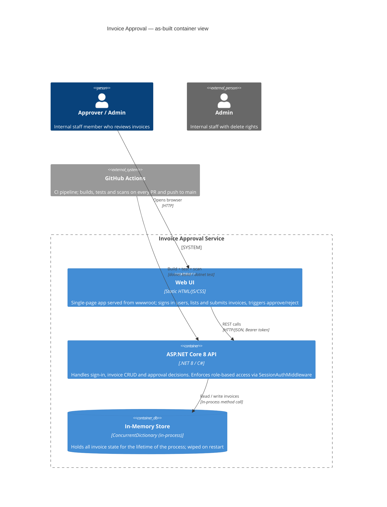
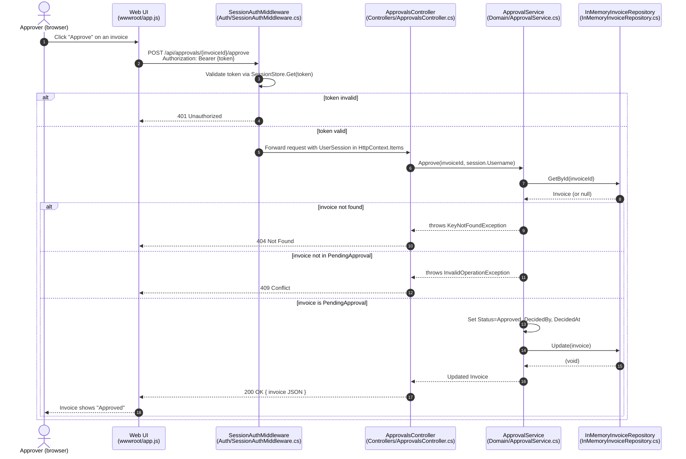

# As-Built Diagrams

These diagrams describe the Invoice Approval service **as the code stands today**,
not the planned production deployment described in `ops/README.md`.

---

## Container View (C4 Level 2)

### Citation list

| Element | Source file / symbol |
|---------|---------------------|
| Web UI container | `backend/src/InvoiceApp.Api/wwwroot/` (index.html, app.js, styles.css) |
| ASP.NET Core API | `backend/src/InvoiceApp.Api/Program.cs` — `var app = builder.Build()` |
| SessionAuthMiddleware | `backend/src/InvoiceApp.Api/Auth/SessionAuthMiddleware.cs` — `InvokeAsync` |
| Role enforcement | `backend/src/InvoiceApp.Api/Auth/RequireRoleAttribute.cs` |
| In-Memory Store | `backend/src/InvoiceApp.Api/InMemoryInvoiceRepository.cs` — `private readonly List<Invoice> _invoices` |
| GitHub Actions CI | `.github/workflows/ci.yml` |
| `IInvoiceRepository` interface | `backend/src/InvoiceApp.Domain/IInvoiceRepository.cs` |
| `ApprovalService` | `backend/src/InvoiceApp.Domain/ApprovalService.cs` |
| Singleton registration | `Program.cs` line `builder.Services.AddSingleton<IInvoiceRepository, InMemoryInvoiceRepository>()` |

### Inferred items (not explicit in code, reasoned from context)

| Item | What was inferred and why |
|------|--------------------------|
| "Browser" as the only client | No mobile SDK, CLI client, or machine-to-machine caller is present. The UI is `index.html` served from `wwwroot`, so the only client type is a browser. |
| HTTP (not HTTPS) for local dev | `launchSettings.json` exposes only port 5000 without TLS; no `UseHttpsRedirection` in `Program.cs`. HTTPS is left to the host in production. |
| No message broker or external system | `ops/README.md` says Azure Service Bus and PayEx are **planned**, not present. No `HttpClient` or Service Bus SDK reference appears in any `.csproj`. |
| Lock-based concurrency in InMemoryInvoiceRepository | The actual `InMemoryInvoiceRepository` in the repository uses a `private readonly object _lock` with `lock(_lock)` blocks rather than `ConcurrentDictionary`. |

---

## Approval Path Sequence Diagram

### Citation list (sequence diagram)

| Step | Source |
|------|--------|
| Bearer token validation | `SessionAuthMiddleware.InvokeAsync` — checks `Authorization` header, calls `_sessions.Get(token)` |
| 401 path | `SessionAuthMiddleware.cs` lines `context.Response.StatusCode = 401; return;` |
| Session forwarded | `context.Items[HttpContextExtensions.SessionKey] = session` |
| `[RequireRole]` on controller | `ApprovalsController.cs` — class-level `[RequireRole("Approver", "Admin")]` |
| `Approve(invoiceId, username)` call | `ApprovalsController.Approve` — `_approvals.Approve(invoiceId, HttpContext.GetSession().Username)` |
| `EnsurePending` guard | `ApprovalService.EnsurePending` — throws `InvalidOperationException` if not `PendingApproval` |
| `KeyNotFoundException` | `ApprovalService.Find` — `?? throw new KeyNotFoundException(...)` |
| Error mapping | `ApiControllerBase.Handle` — catches `KeyNotFoundException→404`, `InvalidOperationException→409`, `ArgumentException→400` |
| Repository update | `InMemoryInvoiceRepository.Update` — `lock (_lock) { _invoices[index] = invoice; }` |
