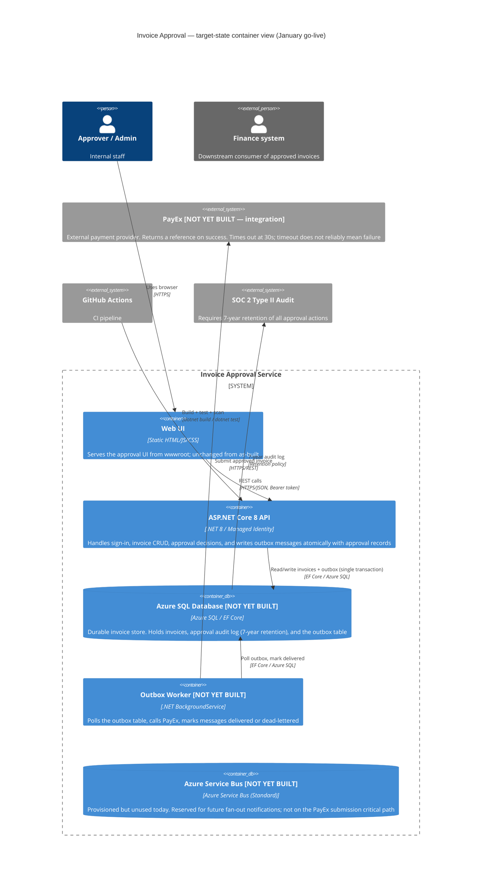

# Target-State Diagrams

These diagrams show the Invoice Approval service **as it will look in January**
when it becomes a tier-2 service: with a real database, an outbox worker, and
the PayEx integration.

Elements that **do not exist yet** are marked `[NOT YET BUILT]`.

---

## Target-State Container View



### What does not exist yet

| Element | Status | Notes |
|---------|--------|-------|
| Azure SQL Database | Not built | `InMemoryInvoiceRepository` is the only persistence today |
| Outbox table in SQL | Not built | No EF Core DbContext exists yet |
| Outbox Worker (`BackgroundService`) | Not built | No worker project in the solution |
| PayEx HTTP client | Not built | No `HttpClient` or PayEx SDK in any `.csproj` |
| Azure Service Bus usage | Not built | Provisioned per ops/README.md; no producer or consumer code exists |
| Managed Identity auth | Not built | Currently demo-account credentials only |
| 7-year audit log retention | Not built | No audit table or retention policy in the codebase |
| EF Core migrations | Not built | No `DbContext` class exists anywhere in the solution |

---

## Target-State Approval + PayEx Submission Sequence

```mermaid
sequenceDiagram
    autonumber
    actor User as Approver (browser)
    participant API as ASP.NET Core API
    participant DB as Azure SQL<br/>[NOT YET BUILT]
    participant Worker as Outbox Worker<br/>[NOT YET BUILT]
    participant PayEx as PayEx API<br/>[NOT YET BUILT — integration]

    User->>API: POST /api/approvals/{id}/approve
    API->>DB: BEGIN TRANSACTION<br/>UPDATE invoices SET status='Approved'<br/>INSERT INTO outbox (invoiceId, idempotencyKey, payload, status='Pending')
    DB-->>API: COMMIT
    API-->>User: 200 OK (invoice approved; PayEx not yet called)

    loop Outbox Worker polls every 10s
        Worker->>DB: SELECT TOP 1 FROM outbox WHERE status='Pending'
        DB-->>Worker: outbox row

        Worker->>PayEx: POST /submissions { invoiceId, idempotencyKey, amount, ... }
        alt PayEx returns 200 with reference
            PayEx-->>Worker: { reference: "PAY-XYZ" }
            Worker->>DB: UPDATE outbox SET status='Delivered', payexRef='PAY-XYZ'
        else PayEx returns 4xx (permanent failure)
            PayEx-->>Worker: 4xx
            Worker->>DB: UPDATE outbox SET status='DeadLettered', failureReason='...'
        else PayEx times out (30s) — ambiguous result
            PayEx-->>Worker: timeout / 5xx
            Worker->>DB: UPDATE outbox SET retryCount=retryCount+1, nextRetryAt=NOW()+backoff
            Note over Worker,DB: Retry with same idempotencyKey.<br/>PayEx deduplicates on key, so retrying is safe.
        else idempotencyKey already seen by PayEx
            PayEx-->>Worker: 200 OK (idempotent replay)
            Worker->>DB: UPDATE outbox SET status='Delivered'
        end
    end
```

### Why this sequence (not the others)

The transactional outbox is chosen because:
1. PayEx times out at 30 seconds and timeout ≠ failure — calling it directly from the approve endpoint would require the API to either wait (risking request timeout) or accept the ambiguity (risking a missed submission or a double submission).
2. Writing the outbox row in the same database transaction as the invoice status change means the two are always consistent: no approved invoice is ever without an outbox entry.
3. The idempotency key lets the worker retry through PayEx timeouts safely.

See `docs/decisions/ADR-001-exactly-once.md` for the full trade-off analysis.
